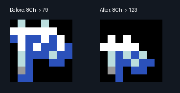
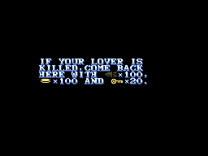

# Galious Enhanced V1.04: Japanese text, font and dialogue fixes

This add-on corrects Japanese text and font defects in Enhanced V1.04. It also fixes legacy resource-picture codes in a shared English message. No cartridge ROM is included.

Apply the original **Galious Enhanced V1.04.ips** to your supported original game ROM first. Then apply **Galious Enhanced V1.04 JP review r7.ips** to the resulting 512KiB Enhanced ROM, SHA-256 `cdeaa916d198a3ca9891076eb79e05709876fa7ce18dcd929e76f1cf25403f53`.

The review patch already includes the earlier **JP fix.ips** corrections. Apply **one** add-on to a clean Enhanced ROM; do not stack the old and new add-ons. The original V1.04 enhancement patch is untouched. The older `build_patch.py`, `manifest.json` and `JP fix.ips` are retained for compatibility; use the new review generator and patch for all fixes below.

## Missing small ya, rather than a spelling mistake

The Aphrodite description already encodes the small **ゃ** as 8Ch. However, the conversion table at RAM 27DDh maps 8Ch to full-size **や** (glyph 79). Neighbouring 8Dh/8Eh correctly map to small **ゅ/ょ** (92/93). Glyph 123 is blank. Add the reviewed, user-edited small ya to that slot and map 8Ch to 123. The visible phrase becomes **3れんしゃできる** (can fire three arrows). All64 pixels of the supplied8×8 artwork (`small-ya.png`) are preserved without resizing or antialiasing; the standalone generator embeds the same4bpp data and does not require an image library. No existing glyph is overwritten. The relocated font's compressed size increases from 3,615 to 3,634 bytes.



## Approved Japanese changes

- `ほのう` → `ほのお` (honoo, flame).
- `し ゆ じんこう` → `しゅじんこう` (shujinkou, player character; small yu and no spaces within the word).
- `じらいを3つおける。。。` → `じらいを3つおける。` (one full stop).
- `CERAMICでできだや。` → `CERAMICでできた、や。` (remove the incorrect dakuten; comma clarifies the following noun ya/arrow).
- `しゅじんこうの たつているFLOOR` → `しゅじんこうの たっているFLOOR` (small tsu).
- Magnifying glass: replace the redundant prefix with `WORLDないのせきひにきざまれている` (inscribed on the stone tablet in the WORLD).
- Move the misplaced space in `FLOORへ とおりていく` to `FLOORへと おりていく`, preserving the original particles.
- Farewell message 10h (16 decimal): `また あおう。` → `また、あおう。` (punctuation cleanup).

JP/EN/ES menu triples are repacked within their original allocations; unused FF bytes follow the Spanish terminator. All eight Japanese entry addresses and calling code remain unchanged. English and Spanish menu texts are byte-for-byte unchanged. The real locale routine at RAM 324Eh is executed for all 24 streams during validation.

## Shared English resource text

Message slots 1Eh/1Fh (30/31 decimal) alias the same English resurrection text in the base message table. Six old icon codes 54h..59h incorrectly display Japanese kana in Enhanced. Remap them to private arrow/coin/key glyphs 117..122. Fix the shared body once, so both references are corrected. These aliases are not a claim that the ordinary English-language conversation uses this table entry.



The included earlier fixes also reconstruct the original arrow/coin/key pictures for Japanese DEATH messages 00h/02h and align Japanese YES/NO message 0Dh with the common hand cursor (EEA9h to EEE9h, 16 pixels down). The enlarged font is relocated into the pinned release's entirely unused bank 12. Regular kana glyphs, neighbouring font assets and executable instructions are preserved; the ROM remains 512KiB.

## Reproduction

The generators use only the Python 3 standard library. Provide your own original MSX ROM (SHA-1 `4d51d3c5036311392b173a576bc7d91dc9fed6cb`) and the pinned clean Enhanced ROM:

```text
python build_review_patch.py original.rom enhanced.rom --output-dir output
```

Use a new output directory. `build_review_patch.py` imports the retained `build_patch.py` and `jp_text_review_fixes.py`; keep them together. The generator checks input identities and never modifies either input. The original ROM supplies the resource-icon patterns. No emulator, screenshot or recording is a build input. This IPS is an add-on for Enhanced, not a patch to apply directly to the original 128KiB cartridge.

| Artifact | Size | SHA-256 |
|---|---:|---|
| Review add-on IPS | 5,107 bytes | `31f5e4f0b677b255c82c0950a41be03b17853f9b14ad8e6877db250d25044824` |
| Generated corrected ROM (not included) | 524,288 bytes | `b81f22ab05fd059e6c1e9d71a8ce2b3d41ba36106fea90e19ada37aadf63c936` |

## Validation

- Independently apply the IPS to the canonical Enhanced ROM and check the corrected-ROM hash. Confirm both input files remain unchanged.
- Execute the actual Enhanced locale-selection instructions for all 8 entries × 3 languages. Check original entry addresses and calling bytes, unchanged English/Spanish menu text, and the untouched staff-roll region.
- Cold-boot the corrected ROM in openMSX (C-BIOS MSX2 JP), verify the relocated font's actual VRAM load, and execute the Z80/V9938 text routines for 8 Japanese descriptions, farewell 10h, and both shared English references: **11 screens, zero pixel differences** against an independent interpretation of the corrected ROM. Apart from the six icon slots and the newly filled small-ya slot, existing font pixels are preserved.
- The previous two-fix version was separately checked with four cold boots and all 60 JP/EN/ES dialogue screens. Those earlier results apply to that earlier artifact; they are not presented as a 60-screen rerun of this review patch.

`validation.json` records artifact/evidence hashes and the tested scope. These are controlled CPU/VDP fixture checks; a complete ordinary-play run, other MSX configurations and physical hardware have not been verified for this patch. The MD port's save-screen, MUSICBOX and other extensions are not included.
